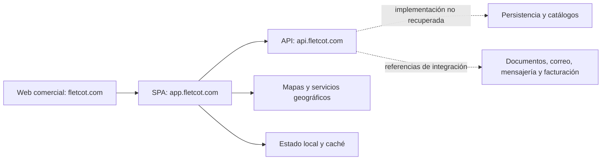

# Arquitectura observada

## Separación de sistemas

Las flechas punteadas son una reconstrucción conceptual; no se inspeccionaron los procesos ni la red interna del servidor.

## Evidencias y confianza

| Conclusión | Evidencia | Confianza / límite |
|---|---|---|
| Web comercial generada con Astro | HTML con atributos/componentes Astro y recursos `/_astro/` | Alta; versión no establecida |
| Aplicación Vue 3.5.31 | Runtime y constante de versión en `index-Clakq0vA.js`; componentes compilados `.vue` | Alta para ese runtime distribuido |
| Compilación Vite y carga por módulos | `__vite__mapDeps`, importaciones dinámicas, recursos con hash | Alta; configuración original desconocida |
| Vue Router | `RouterLink`, `RouterView`, tabla de rutas y guard global | Alta |
| Estado estilo Pinia | Registro de stores, `pinia`, `$state`, `$id`, store de sesión | Alta; no hay manifiesto original de dependencias |
| UI con utilidades CSS y primitives | Clases y runtime de componentes con patrones Tailwind/Nuxt UI/Reka | Alta para patrones; paquete y versión exactos no confirmados |
| API separada | `VITE_CONECTION` apunta a `https://api.fletcot.com/` y composables de datos | Alta |
| Mapbox y MapLibre distribuidos | `useMapbox-CtnLtNn8.js`, `useMaplibre-B0BfLKut.js` | Alta; existencia no garantiza uso simultáneo |
| Geoapify configurado | Nombre de variable en configuración compilada | Alta para referencia; uso efectivo pendiente |
| Documentos y mensajería delegados | Endpoints de exportación y envío en detalle/composables | Alta para referencias; implementación interna desconocida |

No se puede inferir de forma confiable el lenguaje o framework del backend, motor SQL, infraestructura, colas o proveedor de IA. No se inventan Nest, Laravel, PostgreSQL, Redis ni Kubernetes como tecnologías originales.

## Organización del frontend

Los chunks conservan nombres semánticos. Se observan:

- layouts de autenticación y aplicación;
- páginas cargadas bajo demanda;
- componentes de mapa y paneles de cotización;
- composables `useAuth`, `useVehicles`, `useClients`, `useCompany`, `useBilling`;
- acceso HTTP centralizado (`useSimpleFetch` reexporta un cliente compartido);
- caché (`useCacheFetch`) y persistencia local mediante localForage;
- lógica de negocio en `useQuoteCalculation`, `useRentalCalculation`, `useFrozenRecalc`;
- utilidades de geometría y coincidencia de incidencias.

Esta separación se deduce del artefacto compilado. Los nombres no recuperan carpetas originales ni tipos TypeScript. El grafo de importaciones está en `evidence/dependencies.json`.

## Sesión y autorización

El frontend usa solicitudes con `credentials:"include"`. Hay referencias a cookie CSRF, cabecera `X-CSRF-TOKEN` y renovación POST a `/auth/refresh_token`. La sesión consulta `/auth/me`; la navegación comprueba usuario, verificación de correo, vencimiento de prueba, roles y permisos.

No se obtuvieron tokens ni cookies de usuario. No se verificaron atributos HttpOnly/SameSite/Secure ni autorización real del backend. Los guards de navegación no prueban aislamiento de empresas.

Los roles y permisos están separados: por ejemplo, cotizar requiere `agregar:cotizacion`; ver cotizaciones, `ver:cotizacion`; gestión de casetas y plataforma requiere `superadmin`.

## Caché y datos históricos

`useCacheFetch-G9B7R7l9.js` contiene TTL predeterminado de siete días, lectura/escritura persistente, datos en memoria compartidos, deduplicación de solicitudes y cancelación. Esto es caché, no sustituto de la base principal.

La documentación y `useFrozenRecalc-DAdud4PD.js` indican una distinción esencial entre valores actuales e instantáneas guardadas. El reemplazo debe preservar esa distinción, no recalcular silenciosamente cotizaciones viejas cuando cambia el combustible.

## Geografía e incidencias

`roadIncidentMatching-CEDJgMHz.js` consulta celdas geográficas y compara incidentes con segmentos de ruta. El código visible contiene distancia máxima `.035` km y diferencia angular de 60°, además de una proporción mínima `.5` de coordenadas coincidentes. Son constantes del algoritmo observado, no un contrato de proveedor ni exactitud medida.

La presencia de modo camión en documentación no prueba que el proveedor activo respete altura, peso y restricciones de carga. Esto requiere pruebas con rutas conocidas.

## Recuperabilidad

El material obtenido es código de distribución: HTML/CSS, Vue compilado, librerías y lógica minificada. Cuatro chunks contienen ofuscación visible. No se ejecutó ni se desofuscó ese código para reconstruir fuentes originales. No hay referencias a mapas de fuente en los archivos capturados.

Faltan `package.json`, lockfile, fuentes Vue/TypeScript originales, pruebas, migraciones y servidor. Renombrar un `.js` descargado a `.ts` no resuelve esos faltantes.
